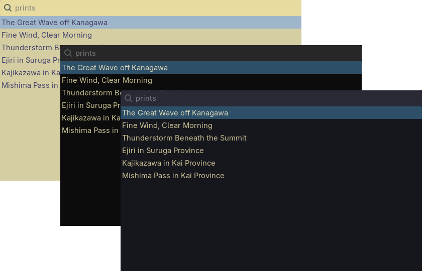
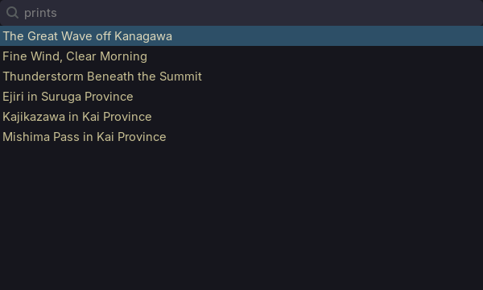
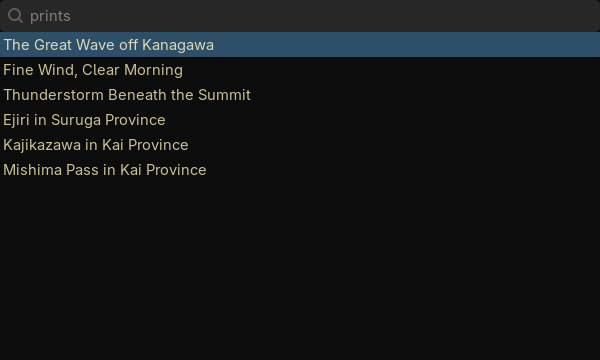
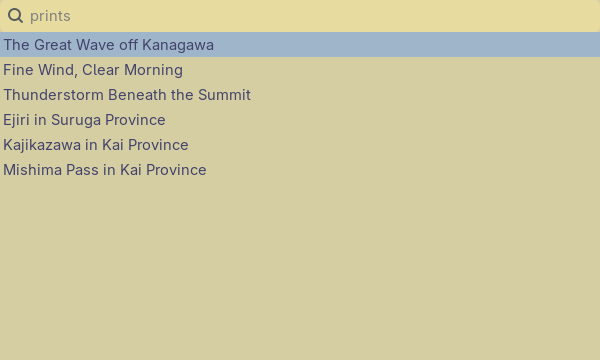

<h3>Kanagawa for <a href="https://hg.sr.ht/~scoopta/wofi">Wofi</a></h3>
<p>A community-maintained theme inspired by Hokusai's <em>The Great Wave off Kanagawa</em>.</p>
<p>Using the <a href="https://github.com/rebelot/kanagawa.nvim">Kanagawa palette</a> by <a href="https://github.com/rebelot">Tommaso Laurenzi (rebelot)</a>.</p>

<!-- Wave accents: carpYellow, crystalBlue, autumnRed. Lotus accents: lotusYellow, lotusBlue4, lotusRed. -->
<p>
  <a href="https://github.com/kanagawa-community/wofi/stargazers">
    <picture>
      <source media="(prefers-color-scheme: dark)" srcset="https://img.shields.io/github/stars/kanagawa-community/wofi?style=for-the-badge&amp;labelColor=1F1F28&amp;color=E6C384">
      <source media="(prefers-color-scheme: light)" srcset="https://img.shields.io/github/stars/kanagawa-community/wofi?style=for-the-badge&amp;labelColor=F2ECBC&amp;color=77713F">
      
    </picture>
  </a>
  <a href="https://github.com/kanagawa-community/wofi/releases/latest">
    <picture>
      <source media="(prefers-color-scheme: dark)" srcset="https://img.shields.io/github/v/release/kanagawa-community/wofi?style=for-the-badge&amp;label=release&amp;labelColor=1F1F28&amp;color=7E9CD8">
      <source media="(prefers-color-scheme: light)" srcset="https://img.shields.io/github/v/release/kanagawa-community/wofi?style=for-the-badge&amp;label=release&amp;labelColor=F2ECBC&amp;color=4D699B">
      
    </picture>
  </a>
  <a href="https://github.com/kanagawa-community/wofi/issues">
    <picture>
      <source media="(prefers-color-scheme: dark)" srcset="https://img.shields.io/github/issues/kanagawa-community/wofi?style=for-the-badge&amp;labelColor=1F1F28&amp;color=C34043">
      <source media="(prefers-color-scheme: light)" srcset="https://img.shields.io/github/issues/kanagawa-community/wofi?style=for-the-badge&amp;labelColor=F2ECBC&amp;color=C84053">
      
    </picture>
  </a>
</p>

<br clear="both">
<br>

## Previews



<details>
<summary>🌊 Wave</summary>

</details>

<details>
<summary>🐉 Dragon</summary>

</details>

<details>
<summary>🪷 Lotus</summary>

</details>

## Requirements

- Wofi 1.2 or later.

## Installation

Download the three themes into ~/.config/wofi:

```sh
mkdir -p ~/.config/wofi
for variant in wave dragon lotus; do
  curl -fsSL -o ~/.config/wofi/kanagawa-$variant.css https://raw.githubusercontent.com/kanagawa-community/wofi/main/themes/kanagawa-$variant.css
done
```

Or clone the repository and run `./install.sh`. It installs all three variants,
or only the ones you name, for example `./install.sh dragon lotus`. `./uninstall.sh`
takes the same names and removes them.

## Usage

Point Wofi at a theme in `~/.config/wofi/config`:

```ini
style=~/.config/wofi/kanagawa-wave.css
```

Or pass `--style ~/.config/wofi/kanagawa-wave.css` on the command line.

## Palette

Every color comes from the shared
[palette](https://github.com/kanagawa-community/.github/blob/main/docs/PALETTE.md),
picked by role, so each variant uses its own value for the same role.

| Wofi color                                       | Palette role                     |
| ------------------------------------------------ | -------------------------------- |
| `@kanagawa_bg`, `@kanagawa_fg`                   | `ui.float.bg`, `ui.float.fg`     |
| `@kanagawa_border`                               | `ui.float.fg_border`             |
| `@kanagawa_input_bg`, `@kanagawa_input_fg`       | `ui.bg_p1`, `ui.fg`              |
| `@kanagawa_selected_bg`, `@kanagawa_selected_fg` | `ui.pmenu.bg_sel`, `ui.pmenu.fg` |
| `@kanagawa_match`                                | `syn.fun`                        |

## Credits

This port replaces the Wofi theme in the `extras` folder of the
[Neovim plugin](https://github.com/kanagawa-community/neovim). Toni Müller first contributed that theme to kanagawa.nvim. The
colors come from [kanagawa.nvim](https://github.com/rebelot/kanagawa.nvim) by
Tommaso Laurenzi.

## Issues and contributions

Report bugs and request changes in this port's
[issue tracker](https://github.com/kanagawa-community/wofi/issues). Contributions are welcome.

See [CONTRIBUTING.md](CONTRIBUTING.md) before opening a pull request.

## License

MIT. See [LICENSE](LICENSE).
